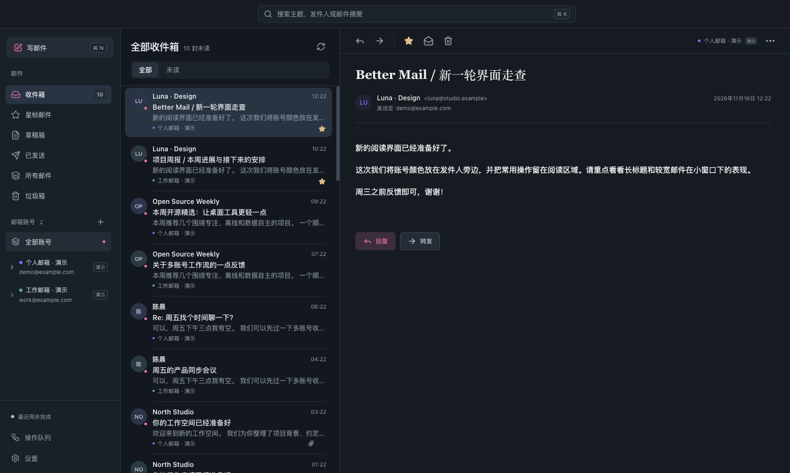
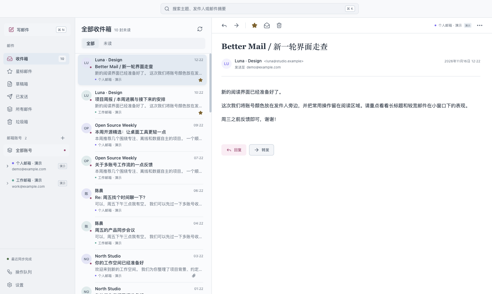

<div align="center">
  
  <h1>Better Mail</h1>
  <p>
    <strong>本地优先的多账号桌面邮箱客户端</strong>
    <br>
    把多个邮箱放进同一个工作区，统一收件、专注阅读、从容回复。
  </p>
  <p>
    <a href="https://github.com/liwenka1/better-mail/releases">
      
    </a>
    <a href="LICENSE">
      
    </a>
    
    
    
  </p>
  <p>
    <a href="https://github.com/liwenka1/better-mail/releases">下载</a> •
    <a href="https://github.com/liwenka1/better-mail">仓库</a> •
    <a href="https://github.com/liwenka1/better-mail/issues">反馈问题</a>
  </p>
</div>

---

## 简介

**Better Mail** 是一款围绕多邮箱收发与本地阅读构建的桌面应用。你可以在统一收件箱里处理多个账号的邮件，也可以进入单个账号和文件夹，让收件、阅读与回复保持清晰的上下文。

- **多账号统一管理**：统一查看邮件，也保留每个账号的独立视图和发件身份。
- **本地优先**：邮件直接与服务商同步，已缓存内容保存在本机，便于搜索与离线阅读。
- **专注邮件内容**：三栏布局、深浅主题、固定阅读操作栏与连贯的正文滚动区域。

## 核心能力

| 功能                 | 说明                                                                                  |
| :------------------- | :------------------------------------------------------------------------------------ |
| **多邮箱接入**       | 支持 QQ、网易和通用 IMAP/SMTP，以及通过官方 API 接入 Gmail、Outlook / Microsoft 365。 |
| **统一收件箱**       | 按账号、文件夹、星标和未读筛选，在统一视图与单个邮箱之间切换。                        |
| **本地搜索**         | 搜索已同步的邮件元数据和摘要，配合分页与虚拟列表浏览邮件。                            |
| **隔离阅读**         | HTML 正文经过清洗并在受限环境中显示，支持切换纯文本。                                 |
| **图片按封加载**     | 远程图片默认拦截；主动加载后保存本地缓存，返回邮件或重启后可复用，隐藏图片保留缓存。  |
| **富文本写信**       | 写信、回复、转发、抄送、密送、附件与本地草稿。                                        |
| **持久化同步与队列** | 增量同步、断线退避、操作恢复，以及发送结果和已发送副本状态展示。                      |
| **账号与外观设置**   | 编辑账号名称和颜色、隐藏与恢复账号，切换深浅主题或自定义主题色。                      |

## 工作流

1. **连接邮箱**：添加 IMAP/SMTP 账号，或通过系统浏览器授权 Gmail、Outlook。
2. **阅读与整理**：在统一收件箱中浏览邮件，用账号、文件夹、未读和星标筛选，按需加载正文与图片。
3. **回复与发送**：确认发件账号后写信或回复，将未完成内容保存为草稿，在操作队列中查看处理结果。

首次启动也可以主动选择演示模式。演示账号仅使用本机模拟数据，不会连接邮箱服务或对外发信。

## 界面预览

以下为实际桌面应用截图，使用独立的本地演示账号，不包含真实邮箱数据。

### 深色主题



### 浅色主题



## 下载

前往 [GitHub Releases](https://github.com/liwenka1/better-mail/releases) 下载对应平台的安装包，并使用发布页中的 `SHA256SUMS.txt` 核对文件。

| 平台        | 架构                  | 安装包              |
| :---------- | :-------------------- | :------------------ |
| **macOS**   | Apple Silicon / arm64 | `.dmg`、`.zip`      |
| **macOS**   | Intel / x64           | `.dmg`、`.zip`      |
| **Windows** | x64                   | `.exe` 安装程序     |
| **Linux**   | x64                   | `.AppImage`、`.deb` |

当前版本尚未配置应用代码签名或 macOS 公证，系统可能提示无法验证发布者。跨平台构建状态见 [GitHub Actions](https://github.com/liwenka1/better-mail/actions/workflows/ci.yml)；构建成功不等同于所有系统和邮箱服务商均已完成实机验证。

### macOS 注意事项

由于应用当前未签名，首次打开时 macOS 可能会提示应用“已损坏”。

```bash
xattr -cr "/Applications/Better Mail.app"
```

执行一次上面的命令后，再重新打开应用即可。

## 连接邮箱

<details>
<summary>QQ、网易及通用 IMAP/SMTP</summary>

先在邮箱服务商处开启 IMAP/SMTP，并生成客户端授权码或专用密码。在设置中选择邮箱预设，或填写服务器地址、端口和用户名。未使用隐式 TLS 的连接必须成功升级至 STARTTLS。

QQ、网易的新账号默认核验服务器已发送副本，缺失时尝试补存。已有账号保留自己的策略。副本补存与邮件投递独立，不会为补存而重新发送邮件。

</details>

<details>
<summary>Gmail</summary>

在自己的 Google Cloud 项目启用 Gmail API，注册桌面 OAuth 客户端。在客户端填写 Client ID 及桌面客户端提供的 Client Secret（如有），通过系统浏览器授权。本机使用随机端口回调、state 和 PKCE；应用请求 `gmail.modify`。OAuth 应用的访问范围和可用账号取决于你的应用配置及服务商要求。

</details>

<details>
<summary>Outlook.com / Microsoft 365</summary>

在 Microsoft Entra 注册允许目标账号类型的桌面应用，配置 `http://localhost` 回调和委托权限 `Mail.ReadWrite`、`Mail.Send`、`User.Read`。填写 Client ID 和适用的租户（通常为 `common`），再通过系统浏览器授权。授权流程也请求 `offline_access`。

</details>

## 数据与当前边界

- 邮件直接与服务商同步，本地数据位于 Electron 的 `userData` 目录。凭据使用系统安全存储加密；邮件数据库（含图片缓存）本身没有应用级静态加密。
- 应用退出后停止收信；离线阅读仅覆盖已缓存的正文和图片。图片缓存有容量与有效期限制，缓存缺失或正文变化时需要再次手动加载；删除账号时一并清理其图片缓存。
- 远程图片加载会连接图片服务器，可能向发件人透露阅读行为；再次阅读时优先复用本地缓存。
- 账号隐藏后继续同步，邮件不再出现在日常邮件视图、搜索、草稿和发件账号选择中；可以从设置恢复。

<details>
<summary>其他功能与服务商限制</summary>

- 搜索覆盖本地元数据和摘要，当前不提供完整正文或附件全文搜索。
- 本地草稿暂不与服务商同步。首次接入、同步位置失效或显式修复可能需要完整元数据扫描，大邮箱首次同步可能较久。
- 发送结果不确定时需要先核对服务商记录，避免重复投递。服务器副本延迟生成时，客户端补存仍可能与服务器产生重复副本。
- 普通 IMAP 邮件跨文件夹移动后可能产生新的本地标识；Gmail / Graph 的跨文件夹身份单独处理。
- 转发引用正文，原邮件附件需另行选择。Graph 当前发送上限为 3 MiB 原始 MIME；普通附件下载上限为 50 MiB。
- 垃圾箱邮件暂不提供彻底删除操作；跨设备同步、日历、联系人、规则和 AI 功能尚未提供。

</details>

## 本地开发

### 环境要求

- Node.js 24。
- pnpm 10.28.2，依赖版本通过 `packageManager` 和锁文件固定。
- 当前系统的原生模块构建工具。

### 安装与启动

```sh
pnpm install --frozen-lockfile
pnpm dev
```

### 检查与构建

```sh
pnpm typecheck   # TypeScript 检查
pnpm check       # 依赖边界、TypeScript 和生产构建
pnpm format:check
pnpm notices     # 更新随应用分发的第三方声明
pnpm package:dir # 生成当前平台的应用目录包
```

生成安装器时，先完成检查和声明生成，再执行：

```sh
pnpm exec electron-builder --publish never
```

输出位于 `release/`。跨平台安装器在对应系统的原生 CI runner 中构建，并检查 Electron SQLite 原生模块和打包后运行时。

主要技术栈：Electron、TypeScript、React、Tailwind CSS、shadcn/ui、TanStack Query / Virtual、Zustand、Tiptap、SQLite / Drizzle、ImapFlow、Nodemailer、MailParser、Google OAuth2Client 与 Microsoft MSAL Node。

## CI 与发布

日常检查和发布使用独立入口，共用同一套平台矩阵和构建步骤。

| 工作流      | 触发方式                | 执行内容                                                         |
| :---------- | :---------------------- | :--------------------------------------------------------------- |
| **CI**      | 推送 main、Pull Request | 四个平台的依赖边界、TypeScript、生产构建与原生 SQLite ABI 检查。 |
| **Release** | 手动输入版本号          | 准备版本、生成四平台安装包、校验运行时与资产后公开发布。         |

在 GitHub 发布新版本：

1. 打开 **Actions → Release → Run workflow**。
2. 选择 **main** 分支，输入版本号，例如 `0.1.1` 或 `v0.1.1`。也支持 `0.2.0-beta.1` 这样的 SemVer 预发布版本。
3. 工作流以 `chore(release): 发布 v版本号` 提交 `package.json` 的版本变更并创建标签，从同一提交完成四个平台构建；全部通过后汇总安装包与 `SHA256SUMS.txt`，公开 GitHub Release。

发布摘要展示源版本、目标版本、源提交、版本提交、平台与下载链接。Release 正文按当前提交历史中最近的已公开版本整理本次变化，并附比较链接；首个版本使用截至该提交的历史。失败留下的标签和草稿不作为变更基线，记录读取或校验失败时停止发布。

<details>
<summary>发布恢复与版本保护</summary>

发布只接受 `main`，标签由工作流管理。准备版本时若发现 `main` 已移动，需要从最新的 `main` 重新发起，避免混合不同提交的源码。

未公开版本失败后可优先使用 **Re-run failed jobs**，已有版本标签会保留原提交。已公开版本会被拒绝，不会覆盖现有安装包。预发布版本标记为 Pre-release；补发较旧正式版时保留现有较新版的 Latest 状态。

普通 CI 只负责构建与原生模块验证；安装包压缩、许可清单生成和上传集中在 Release。单个平台失败也不会公开不完整版本。

</details>

## 提交约定

标题使用 `类型(范围): 中文行为说明`。类型按变化选择 `feat`、`fix`、`refactor`、`ci`、`docs` 或 `chore`，范围指向实际模块，例如 `sync`、`mail`、`accounts`、`settings`、`release`。

```text
fix(sync): 避免切换账号时重复加载邮件
feat(settings): 支持自定义主题色
ci(release): 分离日常检查与手动版本发布
chore(release): 发布 v0.1.1
```

复杂变更在正文补充原因、行为变化、验证结果和未实测范围，简单修改保持一行。每个提交应聚焦一项连贯变更，便于整理发布说明。

## License

项目代码使用 [MIT](LICENSE) 许可。第三方依赖和复制的基础组件保留各自版权与协议，见 [第三方许可声明](THIRD_PARTY_NOTICES.md)。
